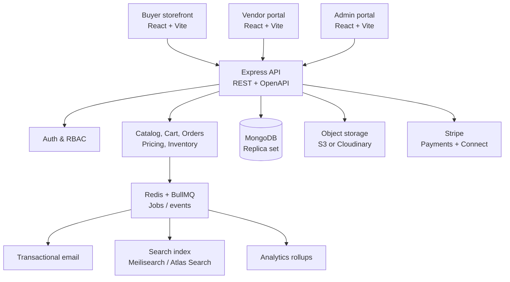

# Multi-Vendor B2B/B2C Marketplace — Architecture & Data Model

## 1. Scope and principles

This design supports a single marketplace where independent vendors sell physical goods to both consumers and business buyers. It is designed around these rules:

- A product and every SKU belong to exactly one vendor.
- A customer checkout can contain goods from multiple vendors.
- Checkout creates one customer-facing **order** and one fulfillment/accounting **vendor order** per vendor.
- Stock is held briefly at checkout, then committed only after payment is confirmed.
- The marketplace is the merchant experience; the payment provider handles payment processing and connected-account payouts.
- Business features (company accounts, negotiated quotes, volume prices and purchase orders) extend the standard B2C flow instead of creating a parallel commerce system.

## 2. Recommended MERN architecture



### Applications

| Component | Recommendation | Responsibility |
|---|---|---|
| Web apps | React, Vite, TypeScript, Tailwind, TanStack Query | Buyer storefront and protected vendor/admin portals. Start as one frontend with role-based route groups; split only when independently deployed. |
| API | Node.js, Express, TypeScript, Zod, Mongoose | Validation, authorization, business rules, payment/webhook orchestration, REST API. |
| Database | MongoDB Atlas replica set | Operational data, transactions for stock/order updates, Atlas Search when appropriate. |
| Cache/queue | Redis + BullMQ | Rate limiting, idempotency, background email, image work, reports, search indexing, expiring stock holds. |
| Payments | Stripe Payment Intents + Stripe Connect | Customer payments, commission/application fees, vendor connected accounts, refunds and payouts. |
| Media | S3-compatible storage or Cloudinary | Product/store assets; store URLs and media metadata in MongoDB, not file bytes. |
| Observability | Sentry + structured logs + metrics | Errors, payment/webhook audit trail, latency and queue monitoring. |

### API module layout

```text
server/src/
  modules/
    auth/ users/ companies/ vendors/ catalog/ inventory/
    cart/ checkout/ orders/ payments/ shipping/ quotes/
    promotions/ reviews/ analytics/ admin/
  shared/
    middleware/ errors/ events/ validation/ permissions/
  jobs/
  config/
```

Keep HTTP controllers thin. Each module owns its request schemas, service/use-case layer, repository/model access, authorization checks, and event publishers. Use an outbox collection or durable queue handoff for side effects after database transactions.

## 3. Identity, tenancy, and roles

`User` is global. A vendor is an organization with one or more vendor users; a business buyer is a company with one or more buyer users. Do not put a mutable `role` field alone on users—membership is the source of truth.

| Role | Scope | Key permissions |
|---|---|---|
| `customer` | Own account | Browse, buy, review, manage addresses/orders. |
| `company_admin` | One company | Invite purchasers, addresses, payment terms, approve orders. |
| `company_buyer` | One company | Buy under company policy, request quotes. |
| `vendor_owner` | One vendor | Billing/payout setup, team, full catalog/orders/reporting. |
| `vendor_manager` | One vendor | Catalog, inventory, fulfillment, dashboard. |
| `vendor_fulfillment` | One vendor | Orders and shipping only. |
| `admin` | Platform | Vendor approval, moderation, commissions, disputes, reporting. |
| `support` | Platform | Read-limited support actions and audit-safe notes. |

Authorization uses `userId`, active vendor/company membership, permission set, and resource ownership. Never rely on a `vendorId` supplied by the browser without verifying membership.

## 4. Collection model

All collections have `_id`, `createdAt`, `updatedAt`; important mutations also record `createdBy`/`updatedBy`. Currency values are integer minor units (`amount: 1299`, `currency: "USD"`), never floats. IDs below are `ObjectId` references unless noted.

### Accounts and organizations

#### `users`

```ts
{
  _id, email, passwordHash, displayName, phone?, avatar?,
  status: 'active' | 'suspended' | 'invited',
  emailVerifiedAt?, lastLoginAt?,
  preferences: { locale, currency, marketingOptIn },
  auth: { refreshTokenVersion, mfaEnabled }
}
```

Unique index: `email` (normalized lowercase).

#### `vendors`

```ts
{
  _id, slug, legalName, displayName, description, logo?, banner?,
  status: 'draft' | 'pending_review' | 'active' | 'suspended' | 'rejected',
  contact: { email, phone },
  addresses: [{ type: 'business' | 'return' | 'warehouse', ...address }],
  settings: {
    fulfillmentLeadDays, returnPolicyUrl?, minimumOrderAmount?,
    allowBackorders, visible
  },
  payment: { stripeAccountId?, onboardingComplete, payoutsEnabled },
  commission: { rateBps, effectiveFrom },
  metrics: { ratingAverage, reviewCount, activeProductCount }
}
```

Unique indexes: `slug`, sparse `payment.stripeAccountId`. `commission` is only the current default; the actual rate is snapshotted onto every vendor order.

#### `vendorMembers`

```ts
{ _id, vendorId, userId, role: 'owner' | 'manager' | 'fulfillment', status: 'active' | 'invited' }
```

Unique compound index: `{ vendorId, userId }`.

#### `companies` and `companyMembers`

```ts
// companies
{
  _id, name, slug?, status: 'active' | 'pending' | 'suspended',
  tax: { id?, exempt: false, certificateUrl? },
  billingAddress: address, shippingAddresses: [{ _id, label, ...address }],
  purchasing: { requireApproval: false, approvalThreshold?: money, paymentTerms?: 'prepaid' | 'net_30' },
  credit: { limit?: money, used: money }
}
// companyMembers
{ _id, companyId, userId, role: 'admin' | 'buyer' | 'approver', spendLimit?: money, status }
```

Unique compound index: `{ companyId, userId }`.

### Catalog and inventory

#### `categories`

```ts
{ _id, parentId?, name, slug, path: [{ _id, slug, name }], image?, sortOrder, isActive, attributes: [] }
```

Unique index: `slug`; index `parentId, sortOrder`. Store the materialized ancestor `path` for fast navigation.

#### `products`

```ts
{
  _id, vendorId, categoryIds: [], slug, title, shortDescription, description,
  brand?, status: 'draft' | 'pending_review' | 'active' | 'archived',
  media: [{ url, alt, type: 'image' | 'video', sortOrder }],
  attributes: [{ key, label, value }],
  options: [{ name: 'Size', values: ['S', 'M'] }],
  variantIds: [],
  seo: { title?, description? },
  rating: { average: 0, count: 0 },
  publishedAt?
}
```

Indexes: unique `{ vendorId, slug }`; `{ vendorId, status }`; text/Atlas Search on title, description, brand, attributes.

#### `productVariants`

```ts
{
  _id, productId, vendorId, sku, barcode?, title,
  optionValues: [{ name: 'Size', value: 'M' }],
  pricing: { list: money, sale?: money, cost?: money, taxCode? },
  dimensions: { weightGrams?, lengthMm?, widthMm?, heightMm? },
  images: [], active: true,
  inventory: { tracked: true, available: 0, reserved: 0, reorderPoint?: 0 }
}
```

Unique indexes: `{ vendorId, sku }`, optional sparse `barcode`. The embedded inventory summary is a denormalized read model; `inventoryItems` is authoritative.

#### `inventoryItems` and `inventoryMovements`

```ts
// stock per SKU / location
{ _id, vendorId, variantId, locationId?, onHand, reserved, available, version }
// immutable ledger
{
  _id, vendorId, variantId, locationId?, type: 'receipt' | 'adjustment' | 'reservation' | 'release' | 'sale' | 'return',
  quantityDelta, reference: { type: 'order' | 'hold' | 'manual', id }, note?, actorId?
}
```

Unique index: `{ variantId, locationId }`. `available = onHand - reserved`; do not let clients calculate or write it. Use a MongoDB transaction with conditional updates (`available >= requestedQty`) to reserve stock.

#### `priceLists` (B2B extension)

```ts
{
  _id, vendorId, companyId?, name, currency, startsAt?, endsAt?, active,
  rules: [{ variantId, minQuantity: 1, unitPrice: money }]
}
```

A list may be public-to-vendor or company-specific. At checkout, resolve the applicable rule and snapshot the resolved unit price to the order item.

### Cart, pricing, and checkout

#### `carts`

```ts
{
  _id, customerId?, companyId?, sessionId?, currency, items: [
    { variantId, vendorId, quantity, addedAt }
  ],
  couponCodes: [], expiresAt?
}
```

Index `customerId`; TTL index on `expiresAt` for guest carts. Prices and shipping are deliberately not authoritative in a cart—recalculate them at checkout.

#### `inventoryHolds`

```ts
{
  _id, cartId?, checkoutToken, vendorId, variantId, quantity,
  status: 'active' | 'consumed' | 'released' | 'expired', expiresAt
}
```

TTL index `expiresAt`. A periodic job releases active expired holds, since TTL deletion alone cannot update inventory counters. Holds typically expire in 10–15 minutes.

#### `promotions`

```ts
{
  _id, scope: 'platform' | 'vendor', vendorId?, code?, type: 'percent' | 'fixed' | 'free_shipping',
  value, currency?, startsAt, endsAt, usageLimit?, perCustomerLimit?,
  conditions: { minimumSubtotal?, categoryIds?: [], productIds?: [], companyIds?: [] }, active
}
```

Unique sparse index `code`. Promotion application is represented as a snapshot in order items/totals, never recomputed for historical orders.

### Orders, payments, fulfillment

#### `orders` — parent customer order

```ts
{
  _id, orderNumber, customerId, companyId?, currency,
  status: 'pending_payment' | 'paid' | 'partially_fulfilled' | 'fulfilled' | 'cancelled' | 'refunded',
  paymentStatus: 'pending' | 'authorized' | 'paid' | 'partially_refunded' | 'refunded' | 'failed',
  shippingAddress: addressSnapshot, billingAddress: addressSnapshot,
  vendorOrderIds: [],
  totals: { subtotal, discount, shipping, tax, grandTotal },
  paymentId?, placedAt?, idempotencyKey, metadata: { source, purchaseOrderNumber? }
}
```

Unique indexes: `orderNumber`, `idempotencyKey`; indexes `customerId, createdAt` and `companyId, createdAt`.

#### `vendorOrders` — fulfillment and settlement boundary

```ts
{
  _id, parentOrderId, vendorId, vendorOrderNumber, customerId, companyId?,
  status: 'awaiting_payment' | 'processing' | 'partially_shipped' | 'shipped' | 'delivered' | 'cancelled' | 'returned',
  items: [{
    variantId, productId, sku, title, optionValues, image?, quantity,
    unitPrice, discount, tax, lineTotal, commissionRateBps, commissionAmount
  }],
  shipping: { method?, cost, address: addressSnapshot, tracking: [{ carrier, number, url?, shippedAt? }] },
  totals: { subtotal, discount, shipping, tax, grandTotal, commission, vendorNet },
  fulfillment: { warehouseLocationId?, shippedAt?, deliveredAt? },
  settlement: { providerTransferId?, status: 'pending' | 'eligible' | 'transferred' | 'reversed' }
}
```

Indexes: `{ vendorId, createdAt }`, `{ parentOrderId }`, `{ vendorId, status, createdAt }`. Every buyer-visible product and price detail is snapshotted so catalog edits cannot change history.

#### `payments`, `refunds`, and `payouts`

```ts
// payment provider interactions are recorded independently from order status
{ _id, orderId, provider: 'stripe', providerPaymentIntentId, amount, currency, status, method?, rawEventIds: [] }
{ _id, orderId, vendorOrderId?, paymentId, amount, reason, providerRefundId, status }
{ _id, vendorId, vendorOrderId, amount, currency, providerTransferId?, status, availableAt? }
```

Unique sparse indexes on external provider IDs. Webhook handlers must be idempotent on the provider event ID; store received events in `webhookEvents` before side effects.

#### `shipments`

```ts
{
  _id, vendorOrderId, vendorId, carrier, service?, trackingNumber?, labelUrl?,
  status: 'label_created' | 'shipped' | 'in_transit' | 'delivered' | 'exception',
  items: [{ vendorOrderItemId, quantity }], shippedAt?, deliveredAt?, events: []
}
```

### B2B workflow, trust, and reporting

#### `quotes`

```ts
{
  _id, quoteNumber, companyId, requesterId, vendorId, status: 'draft' | 'submitted' | 'countered' | 'accepted' | 'declined' | 'expired' | 'converted',
  items: [{ variantId, sku, title, quantity, requestedPrice?, offeredUnitPrice?, notes? }],
  shippingAddress: addressSnapshot?, expiresAt?, messages: [{ authorId, body, createdAt }],
  convertedOrderId?
}
```

Quotes are vendor-specific. A multi-vendor RFQ creates one quote per vendor; an accepted quote locks a price snapshot and converts to a regular order checkout.

#### `reviews`, `notifications`, `auditLogs`, `analyticsDaily`

```ts
// reviews: { productId, vendorId, orderId, customerId, rating, title?, body?, status }
// notifications: { userId, type, data, readAt?, channels, createdAt }
// auditLogs: { actorId?, actorType, action, resource: { type, id }, before?, after?, ip?, createdAt }
// analyticsDaily: { date, scope: 'platform' | 'vendor', vendorId?, revenue, orders, units, refunds, ... }
```

Only customers with fulfilled/eligible order items can review. Treat audit logs and inventory movements as append-only.

## 5. Critical workflows

### Multi-vendor checkout

1. Validate cart ownership, variant status, current price, promotion eligibility, company policy, tax and shipping.
2. Group items by `vendorId`; calculate vendor-level shipping/discount/tax and parent totals.
3. In a transaction, create active `inventoryHolds` and increment `reserved` only if sufficient `available` stock exists.
4. Create the parent `order` and its `vendorOrders` in `pending_payment` / `awaiting_payment` state using immutable snapshots.
5. Create a Stripe Payment Intent with an idempotency key. The client confirms payment.
6. On verified Stripe webhook success, in one transaction: mark payment/order paid, mark vendor orders processing, consume holds, decrement `onHand` and `reserved`, and append `sale` movements.
7. Publish events for confirmation email, vendor notifications, search/metrics updates, and later settlement eligibility.

Never mark an order paid based on a browser callback. The webhook is authoritative.

### Cancellation and refund

- Before shipment, cancel the applicable `vendorOrder`, restore stock through a `return`/`release` movement, and issue a proportional refund.
- For partial fulfillment, refunds and payout reversals are tied to the relevant `vendorOrder` and item quantities.
- Update parent order status from the aggregate state of vendor orders; do not overwrite a delivered vendor order because another vendor’s line was cancelled.

### Inventory concurrency

For each reservation, use a conditional atomic update or transaction equivalent to:

```ts
updateOne(
  { variantId, available: { $gte: quantity } },
  { $inc: { available: -quantity, reserved: quantity }, $set: { updatedAt: now } }
)
```

The operation either reserves every requested line or rolls back. Add a short-lived idempotency record for checkout retries, and version inventory documents if manual adjustments are common.

## 6. API surface (v1)

Use `/api/v1`, JSON, RFC 7807-style error bodies, cursor pagination, and an `Idempotency-Key` header for checkout/payment-changing endpoints.

| Area | Representative endpoints |
|---|---|
| Auth | `POST /auth/register`, `/auth/login`, `/auth/refresh`, `/auth/logout`, `/auth/password-reset` |
| Catalog | `GET /products`, `GET /products/:slug`, `GET /categories`, `GET /vendors/:slug` |
| Cart/checkout | `GET/PUT /cart`, `POST /checkout/quote`, `POST /checkout/payment-intent`, `POST /checkout/confirm` |
| Customer | `GET /me/orders`, `GET /me/orders/:orderNumber`, `POST /reviews` |
| Vendor | `GET /vendor/dashboard`, `CRUD /vendor/products`, `PATCH /vendor/variants/:id/inventory`, `GET /vendor/orders`, `POST /vendor/orders/:id/shipments` |
| B2B | `CRUD /company`, `POST /quotes`, `GET/PATCH /vendor/quotes/:id`, `POST /quotes/:id/accept` |
| Admin | `GET /admin/vendors`, `PATCH /admin/vendors/:id/status`, `GET /admin/orders`, `PATCH /admin/promotions/:id` |
| Webhooks | `POST /webhooks/stripe` — raw body, signature verification, idempotent event storage |

For vendor resources, infer `vendorId` from the authenticated session’s selected vendor membership rather than accepting it freely in every request URL.

## 7. Analytics dashboard

The vendor dashboard should initially display aggregated operational data, not scan all orders live:

- Gross merchandise value, vendor net revenue, order count, average order value, units sold.
- Pending/processing/shipped order counts and revenue awaiting settlement.
- Top products/variants and inventory at/below reorder point.
- Refund rate, cancellation rate, and fulfillment lead time.
- Filters: date range, comparison range, channel, and currency (or normalized reporting currency).

On `order.paid`, `refund.created`, and fulfillment events, enqueue a job that updates daily vendor/platform rollups. Build an admin-only reconciliation report from raw `payments`, `vendorOrders`, `refunds`, and Stripe records; aggregates are not an accounting source of truth.

## 8. Security and operational requirements

- Hash passwords with Argon2id; rotate refresh tokens and store only hashed refresh-token identifiers.
- Use HTTP-only, secure, same-site cookies for refresh tokens; short-lived access tokens.
- Validate every request with Zod; sanitize rich product descriptions; use Helmet, CORS allow-lists, rate limits and CSRF protection when cookie-authenticated.
- Verify Stripe webhook signatures using the raw request body; record and deduplicate event IDs.
- Encrypt sensitive provider/tax metadata at rest where needed; do not store card data.
- Make vendor ownership checks server-side for every mutation and file-upload signature.
- Back up MongoDB, enable point-in-time recovery, test restore procedures, and retain append-only audit/payment records.
- Add distributed tracing/correlation IDs through API requests, jobs, and webhook processing.

## 9. Deployment topology

Deploy the stateless React app to a CDN and the API/workers as separate containers. Use managed MongoDB, Redis, object storage, and a secret manager. Run at least one API and one worker service in production; scale workers separately as image, email, analytics, and webhook demand grows. Configure a staging environment with separate Stripe keys/webhooks and an anonymized seed dataset.

## 10. Delivery plan

### Phase 1 — marketplace foundation

Authentication, vendor onboarding/admin approval, catalog/variants/media, storefront search, cart, a single shipping method, Stripe payment, parent/vendor order split, stock reservation, and basic vendor order management.

#### Next backend milestone: place an order from checkout

The current API can produce a merchandise preview and resolve a customer shipping address. It cannot yet calculate delivery/tax, reserve stock, accept payment, or retain an order. Before implementing order placement, record the launch decisions below; geography, tax responsibility, merchant-of-record, and fulfillment ownership affect the shipping and payment flow.

Implementation checklist:

- [ ] Confirm launch geography, currency, tax responsibility, merchant-of-record, and vendor fulfillment model.
- [ ] Configure one launch shipping method and define how delivery availability and cost are calculated per vendor.
- [ ] Integrate tax calculation for the selected launch market and document rounding/inclusive-price behavior.
- [ ] Recalculate cart prices, address, shipping, tax, and stock on the server when checkout is submitted; reject stale or invalid quotes.
- [ ] Require an `Idempotency-Key` and persist checkout attempts so retries cannot create duplicate orders or holds.
- [ ] In a MongoDB transaction, reserve every cart line conditionally, append inventory movements, and create the parent order plus vendor orders with immutable product, price, address, shipping, tax, and commission snapshots.
- [ ] Add expiring inventory holds and a worker that releases expired holds and updates the inventory ledger.
- [ ] Create the payment intent only after the order and holds are durable; finalize payment and consume holds only from a verified provider webhook.
- [ ] Add customer order history/detail and vendor order list/detail endpoints with ownership checks.
- [ ] Verify competing checkouts cannot oversell, retries are idempotent, and payment failure/timeout releases reserved stock.

Acceptance criteria: a valid checkout creates exactly one parent order and one vendor order per vendor; inventory is reserved atomically; retrying with the same idempotency key returns the existing result; payment status changes only from a verified webhook; and failed or expired payment releases its holds.

### Phase 2 — operating a marketplace

Vendor teams, inventory locations, shipment tracking, promotions, reviews, refunds/returns, notifications, dashboard rollups, reconciliation/audit screens.

### Phase 3 — B2B capabilities

Companies/members/approval policy, tax exemption, price lists and quantity breaks, RFQ/quote conversion, purchase order numbers, credit/payment terms (only after legal/credit controls are established).

### Phase 4 — scale and differentiation

Advanced search, multi-warehouse allocation, multi-currency/tax engine, vendor SLAs, recommendations, API/integrations, and BI exports.

## 11. Decisions to make before implementation

1. Marketplace geography, currency and tax responsibility (this determines tax/shipping integrations).
2. Who is merchant of record and how/when vendors are paid.
3. Product type: physical only, digital, services, or mixed.
4. Fulfillment ownership: vendor-direct, marketplace warehouses, or both.
5. Which B2B features are required at launch: company accounts, price tiers, RFQs, approvals, credit terms.
6. Whether vendors require isolated storefront branding/domains or only marketplace product pages.

These decisions affect integrations and workflows, but the entity boundaries above remain valid across the usual variants.
